  

 

## About

I'm **Rida Ahmed**, a Computer Science student in Karachi, Pakistan, building toward a career in **AI engineering, machine learning and data science**. I work in Python and enjoy turning models and data into applications people can actually use: APIs, dashboards and web interfaces.

Right now I'm:

- building ML-powered apps with **Python** and **Streamlit**
- designing **REST APIs** with **FastAPI**, **Flask** and **Django**
- working with data in **PostgreSQL** and analysing it with Python

 

## Education

| | |
| :-- | :-- |
| **BS Computer Science** — ILMA University | Jan 2025 – Present |
| **Intermediate (Engineering)** — The Kings School | Apr 2021 – Jun 2023 |

 

## Selected Projects

Public repositories on my profile. More are available at [github.com/ridaahmed15](https://github.com/ridaahmed15?tab=repositories).

**Python**

| Project | Stack |
| :-- | :-- |
| [`marksheet.py`](https://github.com/ridaahmed15/marksheet.py) | Python |
| [`nested-decisions`](https://github.com/ridaahmed15/nested-decisions) | Python |
| [`calculator-def`](https://github.com/ridaahmed15/calculator-def) | Python |

**Web**

| Project | Stack |
| :-- | :-- |
| [`portfolio`](https://github.com/ridaahmed15/portfolio) | HTML |
| [`Rubine-cinema`](https://github.com/ridaahmed15/Rubine-cinema) | HTML |
| [`webdev`](https://github.com/ridaahmed15/webdev) | HTML |

<!--
  ADD YOUR ML / DATA SCIENCE REPOS HERE (a new "AI, ML & Data" table above "Python"):
  | [`repo-name`](https://github.com/ridaahmed15/repo-name) | one honest line about it | Python, Streamlit |
-->

 

## Skills

| Area | Tools |
| :-- | :-- |
| **Languages** | `Python` · `HTML` · `CSS` |
| **ML & Data** | `Streamlit` (ML app delivery) · Python data analysis |
| **Backend & APIs** | `Django` · `Flask` · `FastAPI` · REST API design |
| **Data & Tooling** | `PostgreSQL` · `Git` · `GitHub` |
| **Frontend** | `HTML` · `CSS` · `Tailwind CSS` |

 

## Contribution Heatmap

  
   
  Live contribution data, rendered by <a href="https://ghchart.rshah.org">ghchart.rshah.org</a>.

 

## GitHub Statistics

  
  
   
  Live data from the public GitHub API via <a href="https://github.com/anuraghazra/github-readme-stats">github-readme-stats</a>. Private activity is not counted.

 

## Connect

- **Email:** [webdeveloper.ridaa@gmail.com](mailto:webdeveloper.ridaa@gmail.com)
- **LinkedIn:** [linkedin.com/in/ridaahmed-dev](https://www.linkedin.com/in/ridaahmed-dev)
- **GitHub:** [github.com/ridaahmed15](https://github.com/ridaahmed15)

 

  

