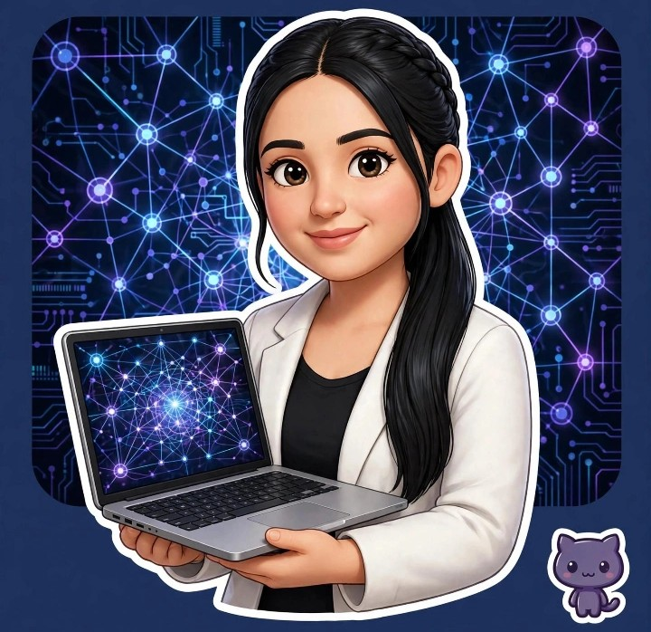

<!-- ===================================================================
     AI Engineer · Machine Learning & Data Science — GitHub Profile README
     Animated neural-network hero/dividers/footer are SVGs with SMIL, which
     animate inline on GitHub. Replace YOUR_GITHUB_USERNAME / YOUR_NAME /
     YOUR_EMAIL / the project repo links before publishing.
     =================================================================== -->

  <!-- ===== Hero portrait (your uploaded header image) ===== -->
  

  <h1>
    
    Hi, I'm <strong>Rida Ahmed!</strong>
  </h1>

  <!-- Animated typing role (external SVG, animates on GitHub) -->
  

  
<em>Building intelligent systems that learn, reason, and scale.</em>

  <!-- Quick focus badges -->
  

    
    
    
    
  

<!-- ============================ DIVIDER ============================ -->

##  &nbsp; About Me

I'm an **AI Engineer** passionate about turning messy, real-world data into
reliable, production-grade intelligence. My day-to-day lives at the intersection
of **machine learning research** and **software engineering** — designing models
that not only score well offline, but also survive contact with users, drift,
and scale.

- 🧠 I work across the full ML lifecycle: **problem framing → data → modelling →
  evaluation → deployment → monitoring**.
- 🔬 Strong fundamentals in **statistics, linear algebra, and optimisation**;
  comfortable reading and reproducing recent papers.
- ⚙️ I care about **reproducibility, MLOps, and observability** as much as about
  the model — a model you can't trust in production is a hobby project.
- 📊 On the **data science** side I love storytelling with data: clean charts,
  honest experiments, and dashboards decision-makers actually use.
- 🌱 Currently exploring **LLM evaluation / RAG reliability**, **uncertainty
  estimation**, and **efficient fine-tuning** (LoRA, quantisation).
- 🤝 Open to collaborating on **open-source ML tooling** and applied research.

<!-- ============================ DIVIDER ============================ -->

##  &nbsp; What I Do

<table>
  <tr>
    <td width="50%" valign="top" background="assets/neural-bg.svg">
      <h3 align="center">🤖 &nbsp; AI Engineering</h3>
      

        Designing and shipping intelligent services — from retrieval-augmented
        generation and agents to classical ML APIs. API design, latency budgets,
        fallbacks, eval harnesses, and the glue that makes models behave in prod.
      

    </td>
    <td width="50%" valign="top">
      <h3 align="center">🧠 &nbsp; Machine Learning</h3>
      

        Supervised / unsupervised / reinforcement learning end-to-end. Feature
        engineering, model selection, hyper-parameter search, cross-validation,
        and rigorous offline + online evaluation against business metrics.
      

    </td>
  </tr>
  <tr>
    <td width="50%" valign="top">
      <h3 align="center">🔮 &nbsp; Deep Learning</h3>
      

        CNNs, RNN/Transformers, and diffusion-style architectures with PyTorch.
        Custom training loops, distributed training, mixed precision, and
        efficient fine-tuning of large pretrained models.
      

    </td>
    <td width="50%" valign="top" background="assets/neural-bg.svg">
      <h3 align="center">📊 &nbsp; Data Science</h3>
      

        Exploratory analysis, causal questions, A/B testing, and decision
        dashboards. Turning ambiguous questions into measurable experiments and
        honest, well-visualised answers for stakeholders.
      

    </td>
  </tr>
</table>

<!-- ============================ DIVIDER ============================ -->

##  &nbsp; Tech Stack

<b>💻 Languages</b>

 

  
  
  
  
  
  

<b>🔬 ML / Deep Learning</b>

 

  
  
  
  
  
  
  
  
  

<b>📈 Data &amp; Visualisation</b>

 

  
  
  
  
  
  
  
  

<b>🚀 MLOps &amp; Cloud</b>

 

  
  
  
  
  
  
  
  
  
  

<b>🛠️ Tools</b>

 

  
  
  
  
  
  
  

<!-- ============================ DIVIDER ============================ -->

##  &nbsp; GitHub Stats

   
  
  
    
  
    
  
   

<!-- ============================ DIVIDER ============================ -->

##  &nbsp; Featured Projects

<table>
  <tr>
    <td width="50%" align="center">
      
      <h3><a href="https://github.com/ridaahmed15/youtube-automation-ai-agent">Youtube Automation Agent</a></h3>
      🚀 Automating the YouTube Content Pipeline with AI!

      

         
         

    </td>
    <td width="50%" align="center">
      
      <h3><a href="https://github.com/ridaahmed15/WEATHERAPP">Weather Forecasting</a></h3>
      
Real-time Weather Forecasting (Streamlit App)🌤

      

         
         

    </td>
  </tr>
  <tr>
    <td width="50%" align="center">
      
      <h3><a href="https://github.com/YOUR_GITHUB_USERNAME/PROJECT_REPO_3">Demand-Forecast</a></h3>
      
Probabilistic demand forecasting for retail SKUs — gradient-boosted
      models + deep AR, with backtesting, drift monitoring, and a Streamlit
      decision dashboard.

      

         
         

    </td>
    <td width="50%" align="center">
      
      <h3><a href="https://github.com/YOUR_GITHUB_USERNAME/PROJECT_REPO_4">Model-Guard</a></h3>
      
CI/CD for ML — DVC pipelines, MLflow tracking, automated data-drift and
      performance-degradation gates before promotion, with shadow + canary
      rollouts.

      

         
         

    </td>
  </tr>
</table>

> 🔗 See more in my **[pinned repositories](https://github.com/YOUR_GITHUB_USERNAME?tab=repositories)**.

<!-- ============================ DIVIDER ============================ -->

##  &nbsp; Let's Connect

  

    
    
    
    
    
  

